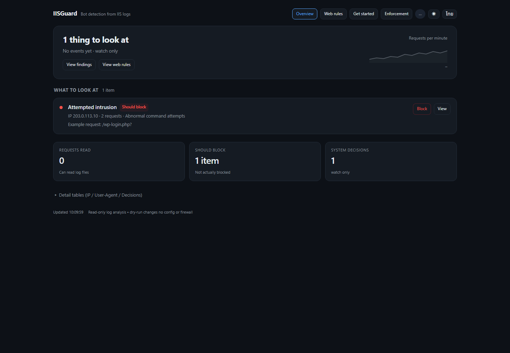
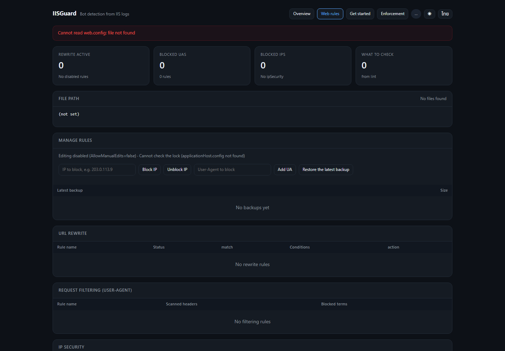

# IISGuard

Reads your IIS logs, scores bots / crawlers / scrapers and tells you what is worth a look — and can block them when you say so.

> **Status: beta** — the default is watch-only (dry run). Nothing is written until you enable enforcement.

Landing page (download + quick start): https://iisguard-bot-iis-log-iisguard-windows-x64-rkz552x8ez.openbot.site

Other language: [ภาษาไทย](README.th.md)

## Download

The zip is attached to [Releases](../../releases/latest) — Windows x64, single file, no .NET install needed.

Inside the zip:

```
iisguard-app.exe              the app (self-contained)
appsettings.json              settings (LogDirectory, Port, WebConfigPath, Enforcement)
web.config                    sample hosting config if the dashboard runs under IIS
wwwroot\fonts\*.woff2         bundled Noto Sans Thai fonts
scripts\install-service.ps1   install as a Windows Service
scripts\uninstall-service.ps1 remove the service
README-อ่านก่อนใช้งาน.txt      Thai quick start
```

## Quick start (3 steps)

1. Unzip anywhere on the IIS machine and double-click `iisguard-app.exe`.
2. Open `http://127.0.0.1:8787`.
3. The setup page finds the log folder by itself. If it cannot, point it at the path the app suggests, then pick **watch** mode.

If you move only the exe, copy `wwwroot` (fonts) and `appsettings.json` with it.

## Requirements

| | |
|---|---|
| OS | **Windows Server 2012 R2 or newer** (x64) — tested on 2012 R2 and 2025 |
| IIS | W3C logging enabled (tested on IIS 8 and IIS 10) |
| URL Rewrite | Optional — when missing or `ipSecurity` is locked, the app uses URL Rewrite; if neither is available it falls back to `ipSecurity` |
| Log read access | A standard user can read logs only if granted on the log folder (IIS allows Administrators by default) |
| Config write access | Real blocking needs an account that can write the site's `web.config` |
| Browser | Needs `fetch` and ES6 — **IE will not work** (current Chrome/Edge, or Edge 109 on 2012 R2) |

## Language

The dashboard ships in Thai and has a built-in English switch:

- Click the **EN / ไทย** button in the header, or
- open any page with `?lang=en` (or `?lang=th`)
- the choice is remembered per browser (localStorage)

Console output, the Windows Event Log and the scheduled-task log stay in English on purpose: Windows Server 2012 R2 consoles often have no Thai font and print `?` instead.





## Install as a Windows Service

```powershell
# Administrator PowerShell
powershell -ExecutionPolicy Bypass -File .\scripts\install-service.ps1
```

It installs to `%ProgramData%\IISGuard`, starts automatically:

```powershell
Get-Service IISGuard
```

Remove it (add `-RemoveData` to delete the database and backups too):

```powershell
powershell -ExecutionPolicy Bypass -File .\scripts\uninstall-service.ps1 -RemoveData
```

## Safe by default

- First mode is watch-only — no config changes.
- Refuses to block private / loopback ranges and the Googlebot range.
- After writing a rule it re-reads the file; when `VerifyUrl` is set and the site answers 5xx it restores the backup automatically.
- Rules expire after 1 h → 24 h → 7 days and remove themselves.
- Removing a rule restores the original file (no leftover `<rewrite><rules /></rewrite>`).
- No telemetry — the dashboard listens on `127.0.0.1` only.

## Terminology (TH ↔ EN)

| English | Thai | Meaning |
|---|---|---|
| Block | บล็อก | Write a deny rule for that IP / UA |
| Throttle | จำกัดความเร็ว | Limit rather than block (not applied by default) |
| Observe | เฝ้าดู | Record only, change nothing |
| Decision | การตัดสิน | The engine's verdict for one entity |
| Dry run | ซ้อม | Compute everything, write nothing |
| Score | คะแนน | 0–100 risk score |
| Never-block | ห้ามบล็อค | CIDRs/IPs that can never be blocked |

## Tested with

| Environment | Result |
|---|---|
| Windows Server 2012 R2 + IIS 8 (Administrator) | Detects the site's own `web.config` · writes real block rules · site still answers 200 · undo restores the original file · `install-service.ps1` → service Running and dashboard 200 |
| Windows Server 2012 R2 (standard user) | Cannot read logs → `/setup` explains "no permission to read this folder" (no crash) |
| Windows Server 2025 + IIS 10 | Blocks a LAN IP with a real 403, undo works, site stays up |
| Sample log, 151,555 requests/day | 53 decisions (2 should block, 10 watch, 41 info) |
| `ipSecurity` locked | Switches to URL Rewrite automatically, XML stays valid |

**Not tested yet:** Windows Server 2016/2019/2022, ARM, firewall-level blocking, MSI installer, out-of-band notifications (email/Teams).

## Notes for 2012 R2

- Runs without installing .NET and without ESU.
- But **Windows Server 2012 R2 has been out of Microsoft support since Oct 2023** — use it on an isolated network or with compensating controls.
- **.NET 8 goes out of support on 10 Nov 2026** — for long-term 2012 R2 support, build a separate .NET Framework 4.8 host (the Core engine is reusable) or move to Server 2016+.

## Help test it

Open an issue with the prepared form:

- [Bug report](../../issues/new?template=bug_report.yml)
- [Unclear wording / usability](../../issues/new?template=usability.yml)
- [Wrong decision (false positive / negative)](../../issues/new?template=detection.yml)
- [Feature request](../../issues/new?template=feature_request.yml)

Do not attach a full `web.config` if it contains customer data — redact everything except the rule section.

## Layout

```
src/IISGuard.Core     parser, normalize, tailer, detection engine
src/IISGuard.Cli      analyze / replay
src/IISGuard.App      service + SQLite + dashboard
src/IISGuard.Tests    regression tests
```

## Build from source

```powershell
dotnet build IISGuard.sln -c Release
dotnet run --project src/IISGuard.Tests -c Release
dotnet publish src/IISGuard.App -c Release -r win-x64 --self-contained true `
  -p:PublishSingleFile=true -p:IncludeNativeLibrariesForSelfExtract=true -o dist\iisguard
```

## License

MIT
