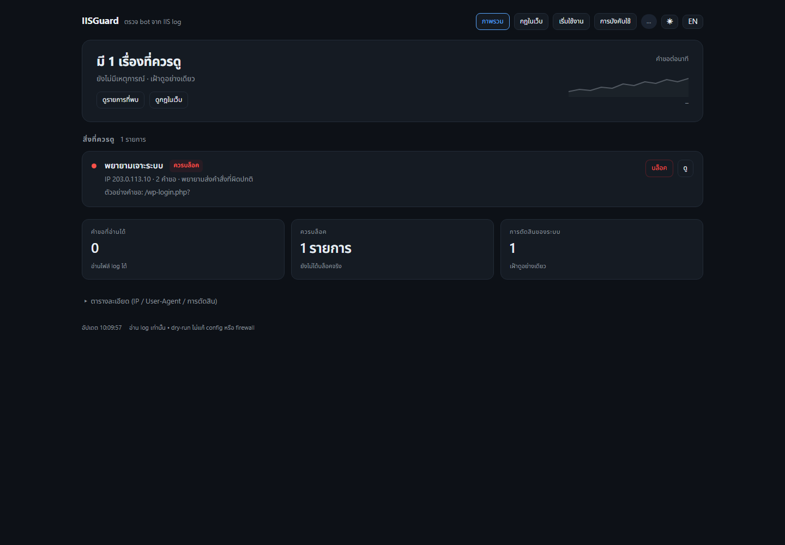
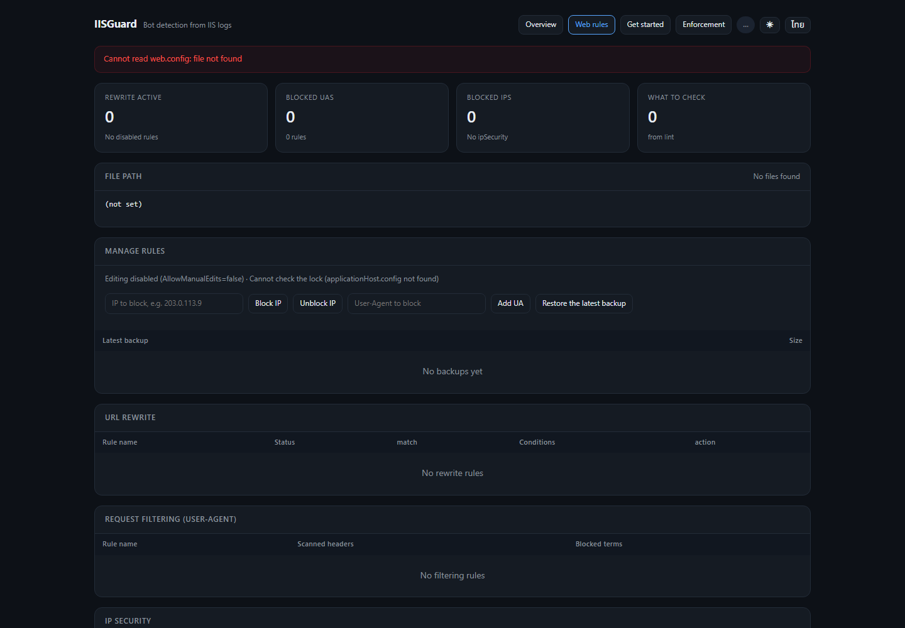

# IISGuard

อ่าน IIS log บนเครื่องคุณ ให้คะแนน bot / crawler / scraper แล้วบอกว่าเรื่องไหนควรสนใจ — และบล็อคได้เมื่อคุณสั่ง

> **สถานะ: รุ่นทดสอบ (beta)** — ค่าเริ่มต้นเป็นโหมดเฝ้าดู (dry-run) ไม่เขียนไฟล์ใด ๆ

หน้าแนะนำ (ปุ่มดาวน์โหลด + วิธีใช้ย่อ): https://iisguard-bot-iis-log-iisguard-windows-x64-rkz552x8ez.openbot.site

ภาษาอังกฤษ: [README.md](README.md)

## ดาวน์โหลด

ไฟล์ zip อยู่ใน [Releases](../../releases/latest) — Windows x64, ไฟล์ single-file ไม่ต้องติดตั้ง .NET

## ภาษา

- หน้าเว็บมีปุ่ม **EN / ไทย** ที่หัวหน้า (จำค่าไว้ในเบราว์เซอร์) หรือเปิดด้วย `?lang=en`
- console, Windows Event Log และ log ของ scheduled task ยังเป็นภาษาอังกฤษโดยตั้งใจ — console ของ 2012 R2 มักไม่มีฟอนต์ไทยแล้วพิมพ์เป็น `?`
- README ภาษาอังกฤษ: [README.md](README.md)




## คำศัพท์

| อังกฤษ | ไทย | ความหมาย |
|---|---|---|
| Block | บล็อก | เขียนกฎปฏิเสธ IP / UA นั้น |
| Throttle | จำกัดความเร็ว | จำกัดแทนการบล็อค (ค่าเริ่มต้นไม่บังคับใช้) |
| Observe | เฝ้าดู | บันทึกอย่างเดียว ไม่แก้อะไร |
| Decision | การตัดสิน | ผลตัดสินของ engine ต่อหนึ่ง entity |
| Dry run | ซ้อม | คำนวณครบแต่ไม่เขียนไฟล์ |
| Score | คะแนน | คะแนนเสี่ยง 0–100 |
| Never-block | ห้ามบล็อค | CIDR/IP ที่ห้ามบล็อคเด็ดขาด |

ใน zip มี:

```
iisguard-app.exe              ตัวโปรแกรม (self-contained)
appsettings.json              ค่าตั้ง (LogDirectory, Port, WebConfigPath, Enforcement)
web.config                    ตัวอย่าง hosting ถ้าเอา dashboard ไปไว้ใต้ IIS
wwwroot\fonts\*.woff2         ฟอนต์ Noto Sans Thai ที่ฝังมา
scripts\install-service.ps1   ติดตั้งเป็น Windows Service
scripts\uninstall-service.ps1 ถอน service
README-อ่านก่อนใช้งาน.txt      วิธีใช้ภาษาไทย
```

## เริ่มใช้ 3 ขั้น

1. แตก zip ไว้ที่ใดก็ได้บนเครื่องที่รัน IIS แล้วดับเบิลคลิก `iisguard-app.exe`
2. เปิดเบราว์เซอร์ที่ `http://127.0.0.1:8787`
3. หน้าเริ่มใช้งานจะหาโฟลเดอร์ log ให้เอง ถ้าไม่พบให้ชี้ path ตามที่โปรแกรมบอก แล้วเลือกโหมด **เฝ้าดู**

ถ้าย้ายเฉพาะ exe ต้องคัดลอก `wwwroot` ไปด้วย (ฟอนต์) และ `appsettings.json`

## ต้องมี

| | |
|---|---|
| OS | **Windows Server 2012 R2 หรือใหม่กว่า** (x64) — ทดสอบแล้วบน 2012 R2 และ 2025 |
| IIS | เปิด W3C logging (ทดสอบบน IIS 8 และ IIS 10) |
| URL Rewrite | ไม่บังคับ — ถ้าไม่มีหรือ `ipSecurity` ถูกล็อค โปรแกรมจะใช้ URL Rewrite; ถ้าไม่มีเลยจะใช้ `ipSecurity` |
| สิทธิ์อ่าน log | ผู้ใช้ทั่วไปอ่าน log ได้ถ้าได้รับสิทธิ์ที่โฟลเดอร์ log (ค่าเริ่มต้นของ IIS อนุญาตเฉพาะ Administrator) |
| สิทธิ์เขียน config | การบล็อคจริงต้องรันด้วยสิทธิ์ที่เขียน `web.config` ของ site ได้ |
| เบราว์เซอร์ | ต้องรองรับ `fetch` และ ES6 — **IE ใช้ไม่ได้** (Chrome/Edge รุ่นใหม่ หรือ Edge 109 บน 2012 R2) |

## ติดตั้งเป็น Windows Service

```powershell
# PowerShell แบบ Administrator
powershell -ExecutionPolicy Bypass -File .\scripts\install-service.ps1
```

ติดตั้งไว้ที่ `%ProgramData%\IISGuard` และสตาร์ทอัตโนมัติ ตรวจสถานะ:

```powershell
Get-Service IISGuard
```

ถอน (เพิ่ม `-RemoveData` เพื่อลบฐานข้อมูลและ backup ด้วย):

```powershell
powershell -ExecutionPolicy Bypass -File .\scripts\uninstall-service.ps1 -RemoveData
```

## ความปลอดภัยเป็นค่าเริ่มต้น

- โหมดแรกคือเฝ้าดู — ไม่แก้ config
- ปฏิเสธการบล็อค IP วงใน / loopback / ช่วง Googlebot
- หลังเขียนกฎ: อ่านไฟล์กลับยืนยัน และถ้าตั้ง `VerifyUrl` แล้วเว็บตอบ 5xx จะย้อน backup ให้เอง
- กฎมีอายุ 1 ชม. → 24 ชม. → 7 วัน แล้วถอนเอง
- ถอนกฎแล้วไฟล์ config กลับสภาพเดิม (ไม่เหลือ `<rewrite><rules /></rewrite>` ค้าง)
- ไม่มี telemetry — dashboard เปิดเฉพาะ `127.0.0.1`

## ทดสอบกับอะไรแล้ว

| สภาพแวดล้อม | ผล |
|---|---|
| Windows Server 2012 R2 + IIS 8 (Administrator) | ตรวจ `web.config` ของ site เองได้ · เขียนกฎบล็อคลงไฟล์จริง · เว็บยังได้ 200 · ถอนคืนแล้วไฟล์กลับสภาพเดิม · `install-service.ps1` → service Running และ dashboard ตอบ 200 |
| Windows Server 2012 R2 (ผู้ใช้ทั่วไป) | อ่าน log ไม่ได้ → `/setup` แจ้ง "ไม่มีสิทธิ์อ่านโฟลเดอร์นี้" (ไม่ crash) |
| Windows Server 2025 + IIS 10 | บล็อค IP ใน LAN ได้ 403 จริง ถอนคืนได้ เว็บไม่ล่ม |
| log ตัวอย่าง 151,555 คำขอ/วัน | 53 การตัดสิน (ควรบล็อค 2, เฝ้าดู 10, ข้อมูล 41) |
| `ipSecurity` ถูกล็อค | สลับไป URL Rewrite อัตโนมัติ XML ยังถูกต้อง |

**ยังไม่ได้ทดสอบ:** Windows Server 2016/2019/2022, ARM, การบล็อคระดับ firewall, ตัวติดตั้ง MSI, การแจ้งเตือนออกนอกเครื่อง (อีเมล/Teams)

## ข้อควรรู้เรื่อง 2012 R2

- โปรแกรมรันได้โดยไม่ต้องติดตั้ง .NET และไม่ต้องมี ESU
- แต่ **Windows Server 2012 R2 หมดรอบซัพพอร์ตของ Microsoft ตั้งแต่ ต.ค. 2023** — ควรใช้กับเครื่องที่แยกเครือข่ายหรือมีมาตรการชดเชย
- **.NET 8 หมดรอบซัพพอร์ต 10 พ.ย. 2026** — ถ้าต้องรองรับ 2012 R2 ระยะยาว ทางเลือกคือทำ build แยกบน .NET Framework 4.8 (Core engine ใช้ซ้ำได้ แต่ต้องเขียน host ใหม่) หรือย้ายไป Server 2016+

## ช่วยทดสอบ

เปิด issue ตามแบบฟอร์มที่เตรียมไว้:

- [แจ้งบั๊ก](../../issues/new?template=bug_report.yml)
- [ใช้งานไม่เข้าใจ / ข้อความกำกวม](../../issues/new?template=usability.yml)
- [ตัดสินผิด (false positive / false negative)](../../issues/new?template=detection.yml)
- [ขอฟีเจอร์](../../issues/new?template=feature_request.yml)

อย่าแนบ `web.config` ทั้งไฟล์ถ้ามีข้อมูลลูกค้า — ตัดเฉพาะส่วนที่ใส่กฎ

## โครงสร้าง

```
src/IISGuard.Core     parser, normalize, tailer, detection engine
src/IISGuard.Cli      analyze / replay
src/IISGuard.App      service + SQLite + dashboard
src/IISGuard.Tests    regression tests
```

## สร้างเอง

```powershell
dotnet build IISGuard.sln -c Release
dotnet run --project src/IISGuard.Tests -c Release
dotnet publish src/IISGuard.App -c Release -r win-x64 --self-contained true `
  -p:PublishSingleFile=true -p:IncludeNativeLibrariesForSelfExtract=true -o dist\iisguard
```

## สัญญาอนุญาต

MIT
